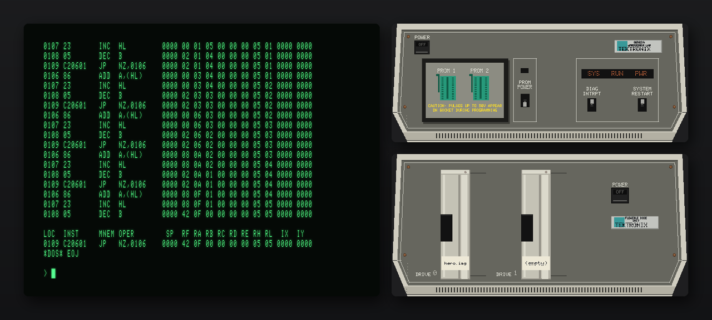

# Tektronix 8002A µProcessor Lab emulator



An emulator of the **Tektronix 8002A µProcessor Lab** (1978–79), a microprocessor development system built around a Signetics 2650. The 8002 is the Millennium Universal One / Signetics TWIN, sold under the Tektronix name. It runs the original bootstrap PROM and boots TEKDOS from emulated 8" disc images.

A sibling of the [Tektronix 8550 MDL emulator](https://github.com/hugojpinto/tektronix-8550-emulator), sharing its CPU cores and design.

## Status
- The real bootstrap PROM (070-2393 Fig. 6-2) boots **TEKDOS 3.1 and 3.3** (6800) to the `>` prompt.
- `LDIR` lists the disc directory. On `Tek8002_1a` it matches the printout photographed with the original disc.
- The Z80 Assembler Processor runs TEKDOS's ASM and LINK; System Communications drive the printer, modem and paper tape ports; FORMAT, COPYSYS and DUP work.
- The disc controller runs its real microprogram (070-2587) against flux-level tracks.
- The **6800 Emulator Processor** runs user programs, and TEKDOS's DEBUG works on it: TRACE, breakpoints, DSTAT, SET. Its lost dump/restore PROM is modelled at high level (`notes/emulators.md`).
- The **Z80 Emulator Processor** does the same on the Z80 TEKDOS discs, and both boards run emulation modes 1 and 2 against a target system over a socket (`-target`, `notes/prototype-link.md`; `tools/proto_target.py` is a reference target).
- Two front ends on one system layer: the terminal (`tek8002`) and a window with a CT8100 screen and the mainframe's and disc unit's front panels (`tek8002-gui`, SDL3).
- Not yet: PROM programmers, the Real-Time Prototype Analyzer, the 8080 board. See [ROADMAP.md](ROADMAP.md).

## Build and run
```
cd emu && make
build/tek8002 -0 ../disks/TekDOS_3.3_6800_cpy1.img
```
The console is your terminal. Ctrl-] opens the monitor (`q` quits). `-1`…`-3` mount more drives, `-rw` makes them writable. The disc controller runs its real microprogram against flux-level tracks; `-fdc hle` uses the high-level model instead (faster discs, same files). `-1 new:FILE` mounts a never-formatted disc, for FORMAT, saved to FILE with `-rw`. `tests/boot_ldir.sh` is the regression test.

```
 TEKDOS  6800    VERSION 3.3
> LDIR

FILE NAME  BLKS

TEKDOS      16
.          176
COPYSYS      1
NEWDISC      1
CHANGE       0
CONCO        1

TOTAL FILES         6
TOTAL BLOCKS USED 203
BLOCKS AVAILABLE  101
TOTAL BAD BLOCKS    8
```

### Options
```
tek8002 [-prom FILE] [-0..-3 IMG|new:FILE] [-rw] [-fdc hle|lle] [-cycles N] [-type SEC|prompt TEXT]
        [-snap SEC FILE] [-input SEC NAME=VALUE] [-press SEC NAME] [-mount SEC N=FILE] [-eject SEC N]
        [-target unix:PATH|tcp:HOST:PORT] [-rem SPEC] [-lpt SPEC] [-ppt SPEC] [-trace FILE] [-io] [-fdutrace] [-log FILE]
```
- `-cycles N`: stop after N 2650 clocks (1,250,000 a second). With `-cycles`, or stdin not a terminal, the run is flat out and deterministic.
- `-type SEC TEXT` types at an emulated second. `-type prompt TEXT` types at the next TEKDOS `> ` prompt; after the last one, a batch run ends at the following prompt.
- `-snap SEC FILE` saves the CT8100 screen as text.
- `-ttylock on|off`: the CT8100's TTY LOCK key, on by default. Lower-case keys go to the 8002 as upper case, because TEKDOS takes commands in upper case only. Scripted `-type` text is sent as written.
- `-input SEC NAME=VALUE` sets a switch; `-press SEC NAME` presses and releases one: `8002:power`, `fdu:power` (rockers), `8002:restart` (SYSTEM RESTART), `8002:diag` (DIAG INTRPT).
- `-mount SEC N=FILE` and `-eject SEC N` change discs while the system runs.
- `-parity SEC ADDR` (System Memory) or `-parity SEC U:ADDR` (program memory, the user address) makes one byte hold bad parity until it is written, as a failing RAM would. TEKDOS reports ERROR 65 or 66.
- `-target`: the prototype for emulation modes 1 and 2. `-rem`, `-lpt`, `-ppt`: the modem, printer and paper tape ports (a socket, a file, or `loop`).

The monitor (Ctrl-]) also presses switches (`p NAME`, `R`, `D`), changes discs (`m N FILE`, `e N`), toggles TTY LOCK (`T`) and injects parity faults (`P [U] ADDR`).

### Graphical front end
```
cd emu && make gui            # needs SDL3: brew install sdl3 / apt install libsdl3-dev
build/tek8002-gui -0 ../disks/TekDOS_3.3_6800_cpy1.img
```
It takes the same options, plus `-cursor steady|blink` (the CT8100's cursor is steady; a strap made it blink), `-style crt|sharp`, `-scale F` (by default the windows fit the screen, centred), `-panels on|off`, `-artwork DIR` and `-shot SEC FILE.bmp`. The shot saves every window (`FILE_8002a.bmp`, `FILE_fdu.bmp`); if the run ends sooner, it is taken at the end.

- **The terminal** is a 24×80 CT8100 in green phosphor, with the control codes of its manual (070-2359, a version of the Tektronix 4023; `notes/ct8100.md`): BS and HT move the cursor without erasing. It also has the terminal's cursor addressing, clear page, read cursor, display fields (inverse, blinking, dim, blanked) and rulings set, for programs that use them. The phosphor colour and the character ROM are not documented, so the font is the one the 8550 emulator uses.
- **The front panels** are drawn after photos of a surviving pair of units (`sources/photos/`) and 070-2701 Fig. 2-6 (`tools/gen_panels.py` writes `emu/artwork/*.lay`):
  - **Mainframe:** POWER, SYSTEM RESTART and DIAG INTRPT work, and SYS, RUN and PWR light. The PROM sockets are decoration.
  - **Disc unit:** POWER works, and each drive has a busy light. Drop a disc image on a drive door to insert it; click the door to take the disc out.
- **Hotkeys** (Cmd, or Ctrl+Alt): V paste, C copy the screen, U TTY LOCK, T turbo, F full screen, S sharp/CRT, P show the panels, L fit the windows to the screen again, R SYSTEM RESTART, Q quit.

What lights SYS and RUN is not described in the manuals. Here, SYS lights while the System Processor holds the bus, and RUN while any processor runs (inferred).

A headless check: `SDL_VIDEODRIVER=dummy SDL_RENDER_DRIVER=software build/tek8002-gui -0 IMG -cycles $((40*1250000)) -type prompt 'LDIR\r' -shot 35 x.bmp`.

## Documentation
- [docs/TUTORIALS.md](docs/TUTORIALS.md): short recipes with pictures: boot, the Z80 and 6800 programs run and debugged, ASM and LINK, the printer and paper tape ports, FORMAT and DUP, modes 1 and 2, a ZX Spectrum as the prototype.
- [docs/OPERATION.md](docs/OPERATION.md): the long tour: both front ends, every option, the monitor, discs, TEKDOS and its pitfalls (upper case and TTY LOCK, BACK SPACE, DEBUG ending with the program).
- [docs/ARCHITECTURE.md](docs/ARCHITECTURE.md): how the 8002A works, and how the code mirrors it.
- [docs/INTEGRATION.md](docs/INTEGRATION.md): for implementers: the prototype link (v1–v4), the serial ports, panel bindings, adding an emulator board.
- `notes/`: the hardware facts, each with how it was established.

The pictures are regenerated by `tools/make_screenshots.sh` (the CT8100, rendered by `tools/render_screens.py`), `tools/make_tutorial_shots.sh` and `tools/make_hero.sh` (the GUI, composed by `tools/compose_gui.py`).

## Wanted
- Dumps of any 8001/8002 emulator board PROMs (e.g. the 6800 board's 82S115 "SYSTEM" and "FETCH"), and of the 8001's TEKOPS PROMs.
- An 8002 diagnostic disc.

## Sources and thanks
Manuals and disc images from [bitsavers](https://bitsavers.org/pdf/tektronix/800x/) and [TekWiki](https://w140.com/tekwiki/wiki/8001). TWIN hardware and OS internals from Eelco Vriezekolk's [2650 Restoration Project](https://ztpe.nl/2650/). The EEVblog thread "Vintage CPU emulator Tektronix 8002 µProcessor Lab" documents a real machine's restoration.

Licence: GPL-2.0-or-later for the emulator code; see [NOTICE.md](NOTICE.md).
