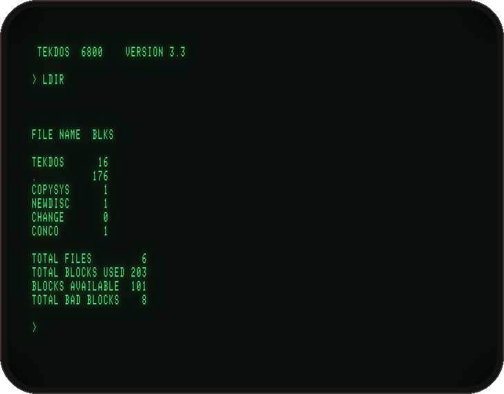
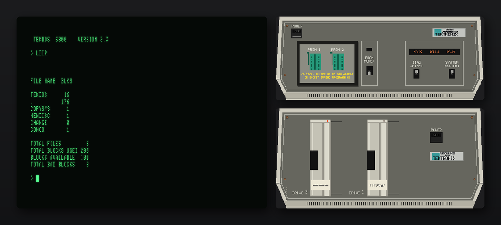
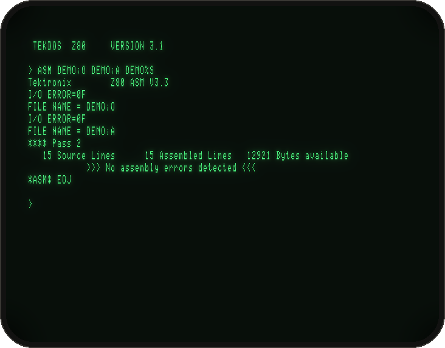
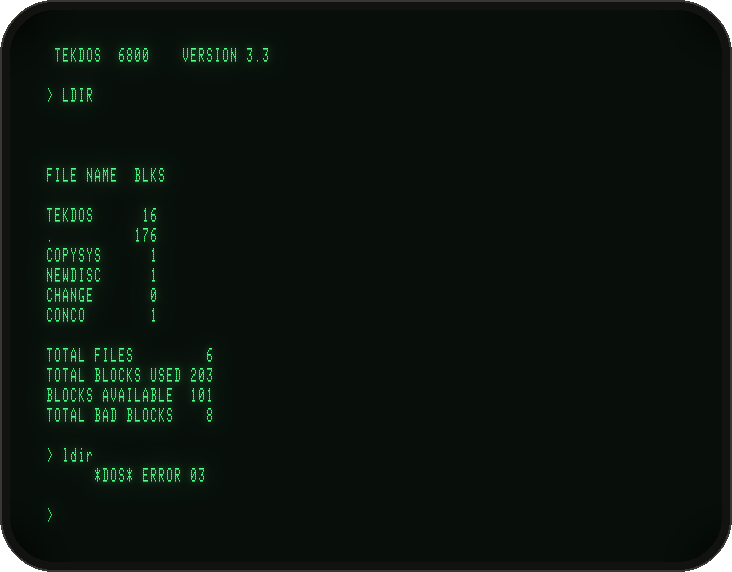
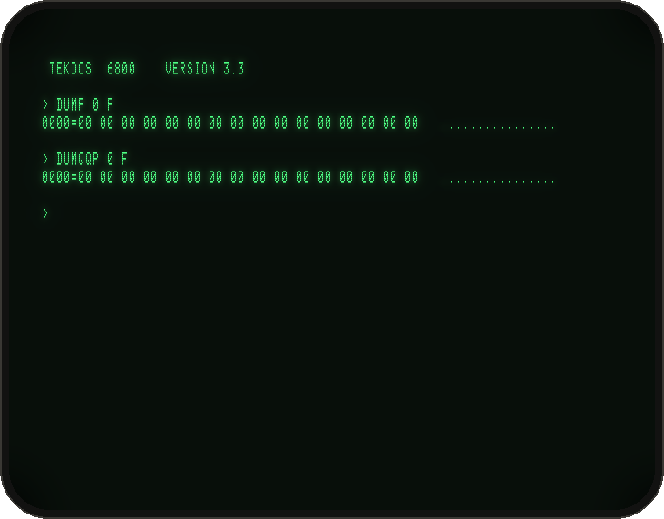
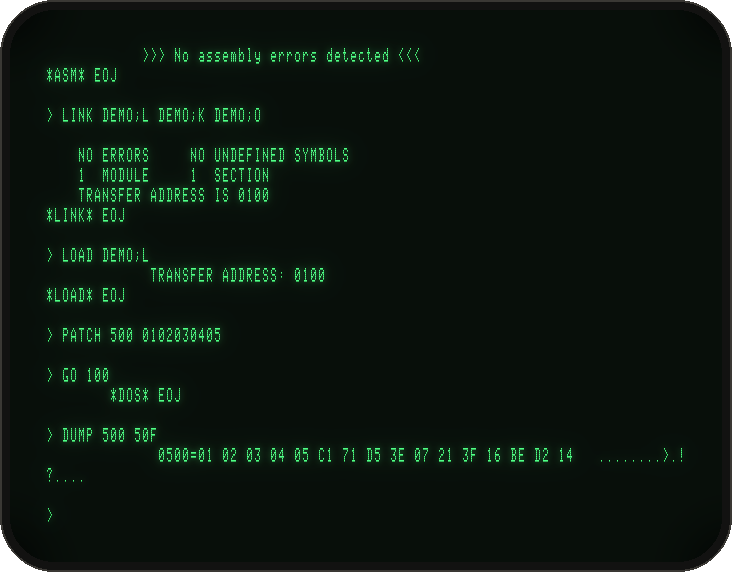
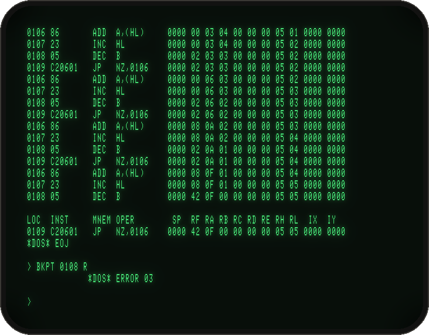
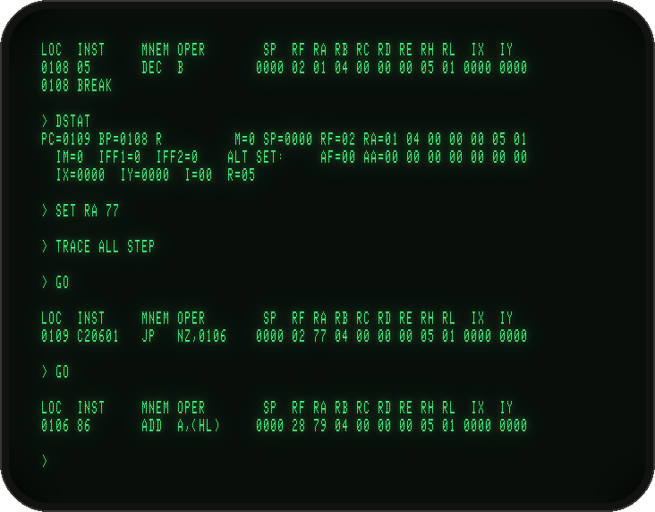
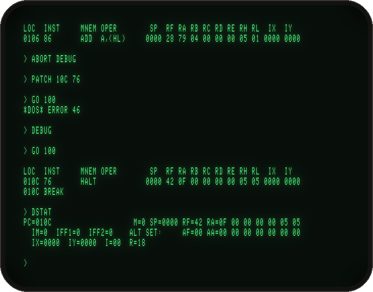
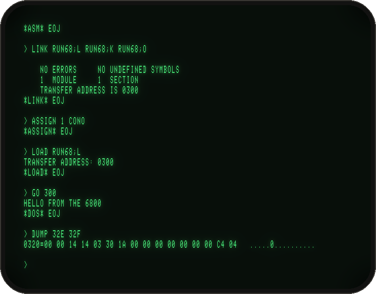

# Operating the emulated Tektronix 8002A µProcessor Lab

This is the long tour: building, the two front ends, every command-line option, the monitor, discs, TEKDOS, and running and debugging programs on the 6800 and Z80 emulator boards, in mode 0 and against a prototype. For short recipes, see [TUTORIALS.md](TUTORIALS.md). For *why* things work the way they do, see [ARCHITECTURE.md](ARCHITECTURE.md). Commands below are run from the repository root unless noted.

Every session shown here was run on the emulator, and the output is copied from it. The pictures come from `tools/make_screenshots.sh`.

## 1. Build and boot

```
make -C emu                  # build/tek8002 and build/dasm; seconds, no dependencies
make -C emu gui              # optional: build/tek8002-gui (SDL3: brew install sdl3 / apt install libsdl3-dev)
make -C emu test             # unit tests and the session tests in tests/
```

Then boot the TEKDOS 6800 system disc:
```
cp sources/bitsavers/disks/TekDOS_3.3_6800_cpy1.img disks/work.img   # your own working copy
emu/build/tek8002 -rw -0 disks/work.img
```

- `-0` puts a disc image in drive 0. Drives 1–3 are `-1` to `-3`.
- `-rw` lets TEKDOS write to the discs and saves them on exit (§5). Use it only on copies. The originals in `sources/` are read-only.
- Your terminal becomes the 8002's system terminal. TEKDOS writes plain text, so any terminal at least 80 columns wide will do.

At power-up the bootstrap PROM reads tracks 1–4 of drive 0 (16K, the operating system) into system memory and jumps to it. With the real disc controller, which turns the disc at its real 360 rpm, the banner and prompt appear after about 12 seconds:
```

 TEKDOS  6800    VERSION 3.3

>
```
Type `LDIR` and Return:



The Z80 system disc, `sources/bitsavers/disks/Tek8002_Belgium_Amusements/Tek8002_10.img`, boots the same way, to `TEKDOS  Z80     VERSION 3.1`. Its "." file holds the Z80 versions of the assembler, the debugger and the emulator commands. TEKDOS is configured for one emulator board per system disc: the 6800 disc drives the 6800 board, and the Z80 disc the Z80 board. Both boards are always fitted in the emulator, and each disc uses its own.

**To leave:** press **Ctrl-]** to open the monitor (§4), then `q` and Return.

## 2. The two front ends

Both front ends drive the same system (`emu/src/system/`) and take the same options (§3).

### The terminal: `tek8002`

Your terminal is the CT8100. Keys go to the 8002 through the CT8100's keyboard model, so TTY LOCK applies (§6.2).

- **Interactive runs** (stdin is a terminal, and no `-cycles`) are paced to real time.
- **Batch runs** (stdin is not a terminal, or `-cycles` is given) run flat out, about 40 times real time with the real disc controller. They are deterministic: the same command line gives the same output, cycle for cycle. The 2650's registers are printed on stderr at the end.

Keys to know:

| Key | Sends | TEKDOS |
|---|---|---|
| Return | CR | ends the line |
| Ctrl-H | BS | BACK SPACE: deletes the last character, not on the screen (§6.3) |
| Backspace | usually DEL, as most terminals send it | RUB OUT: deletes and echoes the deleted character |
| Esc | ESC | stops a running program; under DEBUG it stops with a `BREAK` line |
| Ctrl-] | — | the emulator's monitor, not sent to the 8002 |

### The window: `tek8002-gui`

```
emu/build/tek8002-gui -rw -0 disks/work.img
```

Three windows open, fitted to your screen: the **CT8100** in green phosphor, and the front panels of the **8002A mainframe** and the **Flexible Disc Unit**.



- **Mainframe panel:** POWER, SYSTEM RESTART and DIAG INTRPT work; click them. SYS, RUN and PWR light. The PROM sockets and PROM POWER are drawn only, because the PROM programmers are not emulated.
- **SYS, RUN and PWR** follow the service manual's schematics (`notes/8002.md`, "Front panel lamps"): SYS while the master/slave flip-flop gives the bus to the 2650, RUN while a processor runs and the bus is not held, PWR with +5.2 V. Two points are inferred: that the SYS legend sits over the MASTER LED pair, and that SYS and RUN go dark while SYSTEM RESTART is held.
- **Disc unit panel:** POWER works. Each drive door has a small busy light, an emulator aid that the real unit does not have. Drop a disc image file on a door to insert it, and click the door to take the disc out (saved first, with `-rw`).
- **Keyboard:** Backspace is BACK SPACE, Delete is RUB OUT, Shift-Return is LINE FEED, Ctrl-letters are control codes.

Hotkeys (Cmd on macOS, Ctrl+Alt elsewhere):

| Key | Does |
|---|---|
| V / C | paste text (typed at the terminal port's rate) / copy the screen as text |
| U | the CT8100's TTY LOCK key (shown in the title) |
| T | turbo: run flat out |
| F | full screen |
| S | sharp pixels or the CRT look |
| P | show the panels again |
| L | fit the windows to the screen again |
| R | SYSTEM RESTART |
| Q | quit (discs are saved with `-rw`) |

Options only the GUI takes:

| Option | Does |
|---|---|
| `-style crt\|sharp` | the CT8100's look (default `crt`) |
| `-scale F` | window scale. By default the windows fit the screen, centred |
| `-panels on\|off` | show the front panels |
| `-artwork DIR` | where `8002a.lay` and `fdu.lay` are (default `artwork`, so run from `emu/`, or give `-artwork emu/artwork`) |
| `-cursor steady\|blink` | the CT8100's cursor: steady (default), or blinking, as with its BLINK CURSOR strap |
| `-shot SEC FILE.bmp` | save the windows at emulated second SEC: `FILE.bmp` (the CT8100), `FILE_8002a.bmp` and `FILE_fdu.bmp`. If the run ends sooner, the shot is taken at the end |

With `-cycles` the GUI runs as a batch: flat out, 1/60 s of machine time per frame, deterministic. With `SDL_VIDEODRIVER=dummy SDL_RENDER_DRIVER=software` it needs no display, which is how the pictures in these documents are made:
```
cd emu
SDL_VIDEODRIVER=dummy SDL_RENDER_DRIVER=software build/tek8002-gui -0 ../sources/bitsavers/disks/TekDOS_3.3_6800_cpy1.img \
    -cycles $((40*1250000)) -type prompt 'LDIR\r' -shot 35 x.bmp
```

## 3. Every option

```
tek8002 [-prom FILE] [-0..-3 IMG|new:FILE] [-rw] [-fdc hle|lle] [-ttylock on|off] [-cycles N] [-type SEC|prompt TEXT]
        [-snap SEC FILE] [-input SEC NAME=VALUE] [-press SEC NAME] [-mount SEC N=FILE] [-eject SEC N] [-parity SEC [U:]ADDR]
        [-target unix:PATH|tcp:HOST:PORT] [-rem SPEC] [-lpt SPEC] [-ppt SPEC] [-trace FILE] [-io] [-fdutrace] [-log FILE]
```

**The machine**

| Option | Does |
|---|---|
| `-prom FILE` | the bootstrap PROM image. Default `roms/tekdos_boot.bin`, found from the repository root or from `emu/`. The disc controller's microprogram is read from `fdc/` next to it, and the 6800 and 8080 boards' PROMs from `ep6800/` and `ep8080/` |
| `-0` … `-3 IMG` | a disc image in drive 0–3: a raw image of 315,392 bytes (77 tracks × 32 sectors × 128 bytes, in logical order) |
| `-0` … `-3 new:FILE` | a never-formatted disc, with no flux at all; FORMAT it, and with `-rw` it is saved to FILE |
| `-rw` | discs are writable, and saved on exit or eject. Without it, every disc is write-protected (§5) |
| `-fdc lle` | the disc controller runs its real microprogram against flux-level tracks (the default) |
| `-fdc hle` | the high-level disc model instead: the same files, faster, and no real timing |
| `-ep6800 prom` | the 6800 board runs its dumped SYSTEM and FETCH PROMs (`roms/ep6800/`, next to the bootstrap PROM; the default) |
| `-ep6800 hle` | the 6800 board's firmware routines at high level instead (the same results) |
| `-epz80 prom` | the Z80 board runs its firmware (`roms/epz80/z80_firmware.bin`, rebuilt by `tools/rebuild_z80_firmware.py`; the default) |
| `-epz80 hle` | the Z80 board's firmware routines at high level instead (the same results) |
| `-ttylock on\|off` | the CT8100's TTY LOCK key, on by default (§6.2) |

**Scripting** (`SEC` is emulated seconds; the 2650 runs at 1,250,000 cycles a second)

| Option | Does |
|---|---|
| `-cycles N` | stop after N 2650 cycles; the run is a batch run |
| `-type SEC TEXT` | type TEXT at second SEC. Escapes: `\r` Return, `\n`, `\t`, `\\`, `\xHH` |
| `-type prompt TEXT` | type TEXT at TEKDOS's next `> ` prompt, once it has stood for 0.1 s. Several are typed in order, one per prompt. In a batch run, the run ends at the prompt after the last one |
| `-snap SEC FILE` | save the CT8100 screen as text (24 lines) |
| `-input SEC NAME=VALUE` | set a switch: `8002:power=0` |
| `-press SEC NAME` | press and release a switch: `8002:restart`, `8002:diag` |
| `-mount SEC N=FILE` / `-eject SEC N` | change the disc in drive N while the system runs |
| `-parity SEC ADDR` / `-parity SEC U:ADDR` | give one byte of System Memory, or of program memory at a user address, bad parity until it is written, as a failing RAM would (§10) |
| `-log FILE` | every character the 8002 sends to the terminal |

`-type` text goes to the 8002 as written: TTY LOCK does not apply to it, so script commands in upper case. Use `-type prompt` rather than fixed times: with the real disc controller, how long a command takes depends on where the disc is in its turn.

The switch names: `8002:power` and `fdu:power` are rockers (1 on, 0 off; at power-up the bootstrap runs again). `8002:restart` is SYSTEM RESTART: the 2650 restarts when it is let go. `8002:diag` is DIAG INTRPT, the Debug module's interrupt 28.

**Links**

| Option | Does |
|---|---|
| `-target unix:PATH\|tcp:HOST:PORT` | the prototype that the emulator boards' modes 1 and 2 use (§8) |
| `-rem SPEC` | the modem port, J101 (TEKDOS's REMI and REMO) |
| `-lpt SPEC` | the line printer port, J102 (LPT1) |
| `-ppt SPEC` | the paper tape port, J103 (PPTR and PPTP) |

A SPEC is `file:PATH` (what the port sends is appended to PATH), `tcp:HOST:PORT` (connect to a program), `listen:PORT` (wait for one on 127.0.0.1), `unix:PATH`, or `loop` (a wrap-back plug: what the port sends comes back). The ports run at 2400 baud.

**Tracing** (on stderr)

| Option or variable | Logs |
|---|---|
| `-io`, `TEK_IOTRACE=1` | every 2650 port access, and a slave's I/O that no board takes |
| `-fdutrace`, `TEK_FDCTRACE=1` | every disc strobe and byte; under `-fdc hle`, sector reads and writes |
| `TEK_EPTRACE=1` | slaves' forced jumps, debug interrupts, the emulator firmware's calls |
| `TEK_INTTRACE=1` | interrupts taken |
| `-trace FILE` | every 2650 instruction, disassembled |

## 4. The monitor

Ctrl-] in the terminal front end stops the machine and opens the monitor. It shows the 2650's registers and the instruction at PC.

| Command | Does |
|---|---|
| `c` or Return | continue |
| `q` | quit (discs are saved with `-rw`) |
| `r` | the 2650's registers |
| `d [ADDR [N]]` | dump N bytes of the 2650's memory (default 64, at PC) |
| `u [ADDR [N]]` | disassemble N 2650 instructions |
| `s [N]` | single-step the 2650 N instructions |
| `i` | port tracing on/off (as `-io`) |
| `R` | press SYSTEM RESTART |
| `D` | press DIAG INTRPT |
| `T` | TTY LOCK on/off |
| `P ADDR`, `P U ADDR` | a parity fault in System Memory, or in program memory at a user address (as `-parity`) |
| `p NAME` | press a switch for 0.2 s and let it go: `p 8002:restart`, `p 8002:diag`. A rocker (`8002:power`, `fdu:power`) is left off by this; set rockers with `-input` |
| `m N FILE` | put FILE in drive N |
| `e N` | take the disc out of drive N (saved first, with `-rw`) |
| `h` | help |

## 5. Discs

The Flexible Disc Unit has two 8" drives, single-sided, single density: 77 tracks of 32 hard sectors of 128 bytes. A second unit gives drives 2 and 3. Images are raw, in logical sector order, 315,392 bytes; `sources/bitsavers/disks/` has 33 of them.

**Write protection.** Without `-rw`, every disc is write-protected, as if its write-enable tab were off. TEKDOS then fails every write with I/O ERROR 0F, "Directory write error" (070-2706 §8). Reading is unaffected, and some programs carry on. ASM, for example, reports no assembly errors, but its object and listing files were never written:



So, to work on a disc:
```
cp sources/bitsavers/disks/Tek8002_Belgium_Amusements/Tek8002_10.img disks/z80.img
emu/build/tek8002 -rw -0 disks/z80.img
```
With `-rw`, each disc is saved on exit, or when it is ejected. Under the real controller, what is saved is what the tracks decode to; a sector that does not decode is saved as zeros, with a warning.

**Blank discs.** `-1 new:disks/blank.img` puts a never-formatted disc in drive 1, with no flux on it at all. `FORMAT 1 NAME` formats it (§6.5), and with `-rw` it is saved to `disks/blank.img`. FORMAT of such a disc gives an image byte-identical to a real formatted disc from the collection (`Tek8002_1b`).

**Changing discs while running:** `-mount SEC N=FILE` and `-eject SEC N` on the command line, `m N FILE` and `e N` in the monitor, or drag and drop on the GUI's drive doors.

**Putting files on a disc.** TEKDOS has an editor (EDIT, 070-3441). From outside, the sibling tool `../tekmato` reads and writes TEKDOS discs (`tkdos-sssd`):
```
../tekmato/tekmato -open disks/work.img -write mysource.s 'MINE;S' text -save
../tekmato/tekmato -open disks/work.img -type 'MINE;A'          # print a file
../tekmato/tekmato -open disks/work.img -check -info
```

## 6. TEKDOS

TEKDOS's reference is the 8002A System Reference Booklet, 070-2706 (`sources/bitsavers/manuals/800x/`, with OCR text). This section covers what you need to start, and what trips people up.

### 6.1 Commands and files

- A command is a word and its parameters, separated by spaces. Numbers are hexadecimal.
- A file name has up to eight characters and starts with a letter; `;` and `%` are allowed. By convention the last character is the type, after `;` for a temporary file or `%` for a permanent one: `S` source, `O` object, `L` load module, `A` assembler listing, `K` linker listing.
- A file on another drive is `NAME/1`. Commands run from the system disc in drive 0.
- `*DOS* ERROR nn` is a TEKDOS error; `*NAME* EOJ` means a command has finished. The error codes are in 070-2706 §8.

| Command | Does |
|---|---|
| `LDIR [drive] [device]` | list a disc's directory; `LDIR 0 LPT1` prints it |
| `COPY FROM TO` | copy a file, to a file or a device: `COPY DEMO%S CONO` shows it on the console |
| `DELETE`, `RENAME` | file housekeeping |
| `ASM OBJ LIST SOURCE` | assemble, on the Assembler Processor: `ASM DEMO;O DEMO;A DEMO%S` |
| `LINK LOAD LIST OBJ…` | link: `LINK DEMO;L DEMO;K DEMO;O` |
| `LOAD FILE` | load a load module into program memory |
| `GO [addr]` | run it on the emulator board |
| `DUMP lo hi`, `PATCH addr bytes`, `MOVE`, `FILL`, `EXAM` | look at and change memory |
| `ASSIGN n DEVICE` | connect channel n to a device or file (a program's SVCs use channels) |
| `EMULATE n`, `MAP` | emulation mode 0, 1 or 2; the memory map (§8) |
| `DEBUG` | enter the debug system (§7) |
| `FORMAT drive name`, `DUP from to [name]`, `COPYSYS from to` | disc tools (§6.5) |
| `STATUS` | what is running, suspended or under debug |

### 6.2 Upper case only, and TTY LOCK

TEKDOS takes commands in upper case only ("UPPERCASE words must be entered exactly as shown", 070-2706). A lower-case command is not found: `ldir` gives `*DOS* ERROR 03`, "Commandfile not found".



So **TTY LOCK is on by default**. On the CT8100 it is a latching key: "All lower case characters are then displayed and/or transmitted as upper case characters, regardless of condition of SHIFT key" (070-2359 p. 1-14). With it down, you can type `ldir` and TEKDOS receives `LDIR`. Turn it off with `-ttylock off`, Cmd-U in the GUI, or `T` in the monitor, for example to type lower case into the editor.

Its state on a real 8002 is not documented: the key stays as the last operator left it. On by default is this emulator's choice, because every session in the manuals is upper case (`notes/ct8100.md`).

Text given with `-type` is sent as written, past TTY LOCK. The `ldir` in the picture above was typed that way.

### 6.3 BACK SPACE and RUB OUT

The CT8100's **BACK SPACE is not destructive**: it moves the cursor left without erasing ("Does not destroy data", 070-2359). TEKDOS's line input handles the two delete keys differently (070-2706: BACK SPACE deletes "but not display", RUB OUT "deletes and displays"):

- **BACK SPACE** (Ctrl-H; Backspace in the GUI) deletes the last character and echoes a bare BS. The deleted character stays on the screen until you type over it.
- **RUB OUT** (DEL; Delete in the GUI, and the Backspace key of most terminals) deletes the last character and echoes it again.

Here `DUMQ`, BACK SPACE, `P 0 F` and then `DUMQ`, RUB OUT, `P 0 F`. Both lines run `DUMP 0 F`:



In the first line the `P` was typed over the `Q`. In the second, the deleted `Q` was echoed.

### 6.4 The CT8100 screen

The CT8100 (070-2359) is Tektronix's version of its 4023 terminal: 24 lines of 80 characters. It is modelled in DIRECT mode, from its manual (`notes/ct8100.md`).

- **What TEKDOS uses:** BS and HT move the cursor without erasing, LF moves down and rolls the screen past the 24th line, CR returns to the left margin, BEL beeps, and DEL neither writes nor spaces.
- **The LF DOES CR strap is set:** a line feed also returns the carriage. TEKDOS echoes Return as LF (and DC3) with no CR, so the lab's terminal must have had this strap; without it, TEKDOS's next output would start where the command line ended (inferred from that echo).
- **For your programs,** the terminal's host features are there too: cursor addressing (FS, column + 32, line + 32), clear page (ESC FF), read cursor (ESC ], answered with GS X Y CR), display fields (US and a field attribute code: inverse, blinking, dim, blanked, protected), clear input (ESC O), and the optional rulings set (SO/SI). They are drawn by the GUI. The terminal front end passes the 8002's output to your own terminal as it is, so a program that uses them needs `tek8002-gui`.
- **The cursor is steady,** as on the standard terminal: "The standard 4023 does not blink the cursor" (p. 2-2). The BLINK CURSOR strap made it blink; `-cursor blink` in the GUI sets it. Blinking fields and the strapped cursor blink at 1 Hz (inferred).
- Not modelled: BUFFER mode and its keyboard editing, the send-page commands, hard copy (`notes/ct8100.md`).
- The CT8100's character generator and its phosphor colour are not documented. The font is the one the sibling 8550 emulator draws its CT8500 with, and the green is a choice.

### 6.5 FORMAT, DUP and COPYSYS

```
emu/build/tek8002 -rw -0 disks/work.img -1 new:disks/blank.img
> FORMAT 1 SCRATCH          format drive 1 and name it
> DUP 0 1 BACKUP            copy every file of drive 0 onto it, and name it BACKUP
> COPYSYS 0 1               or: copy only the system (TEKDOS, ".", COPYSYS, NEWDISC), to make it bootable
```
FORMAT writes all 2,464 sectors through the real controller. A FORMAT and a DUP take about 15 minutes of machine time (under a minute in a batch run). [TUTORIALS.md §6](TUTORIALS.md#6-format-a-disc-and-duplicate-the-system-disc) shows the session.

## 7. Running and debugging programs

The 8002A runs your program on an **emulator processor board**, a real 6800 or Z80 that takes over the program memory while the 2650 waits (ARCHITECTURE.md §4). TEKDOS's tools run on another slave, the Z80 Assembler Processor.

### 7.1 Build and run

Tektronix's Z80 demonstration, `DEMO%S` on the Z80 system disc, adds five bytes from a table at 0500 and exits to TEKDOS by SVC:
```
> ASM DEMO;O DEMO;A DEMO%S
> LINK DEMO;L DEMO;K DEMO;O
> LOAD DEMO;L
> PATCH 500 0102030405       the table
> GO 100
*DOS* EOJ                    the program's exit SVC
```



`*DOS* EOJ` is TEKDOS reporting that the program ended by its exit SVC (an `OUT (0F7H),A` with an exit request block at 0040). A Z80 HALT or 6800 WAI instead gives `*DOS* ERROR 46`, "Emulator halted".

### 7.2 The debug system

`DEBUG` enters the debug system. Its commands (BKPT, CLBP, DISM, DSTAT, SET, TRACE, RESET, CAL, and GO with breakpoints and tracing) exist only there; outside it they give ERROR 03.

| Command | Does |
|---|---|
| `TRACE ALL` | print every instruction as it runs, with the registers after it |
| `TRACE ALL STEP` | stop after each traced instruction; `GO` steps on |
| `TRACE OFF` | no tracing |
| `BKPT addr R\|W` | break when the program reads (fetches included) or writes addr |
| `CLBP` | clear the breakpoints |
| `DSTAT` | the registers, breakpoints and emulation mode |
| `SET RA 77` | set a register (`RA` A, `RB` B…; `RA 11 22` sets A and B on the 6800) |
| `GO [addr]` | run, or continue after a break |
| `ABORT DEBUG` | leave the debug system |

**DEBUG ends when the program exits.** When the program ends by its exit SVC (`*DOS* EOJ`), TEKDOS leaves the debug system too. A BKPT or DSTAT after that gives ERROR 03:



So type `DEBUG` again before the next run, and set breakpoints after `DEBUG` and before `GO`. A program stopped by a breakpoint, a step or ESC stays under debug: `GO` continues it.

A breakpoint, DSTAT, SET and single steps on the DEMO:
```
> DEBUG
> BKPT 0108 R                break when 0108 is read, i.e. when DEC B is fetched
> GO 100
0108 05       DEC  B          0000 02 01 04 00 00 00 05 01 0000 0000
0108 BREAK
> DSTAT
PC=0109 BP=0108 R          M=0 SP=0000 RF=02 RA=01 04 00 00 00 05 01
  IM=0  IFF1=0  IFF2=0    ALT SET:     AF=00 AA=00 00 00 00 00 00 00
  IX=0000  IY=0000  I=00  R=06
> SET RA 77
> TRACE ALL STEP
> GO                         one instruction: JP NZ, with A = 77
> GO                         the next: ADD A,(HL) gives 79
```



The trace line's columns are the instruction (`LOC INST MNEM OPER`) and the registers after it: `SP`, then `RF RA RB RC RD RE RH RL` (F A B C D E H L), `IX`, `IY`. On the 6800 they are `RA RB XREG SP CC`, with the effective address in `X/PC EADD`.

A HALT outside DEBUG gives ERROR 46. Under DEBUG it is a break, and the program resumes at the HALT:



**Esc** stops a running program. Under DEBUG it prints the trace line of the instruction it stopped at and `BREAK`; `GO` continues.

### 7.3 The 6800

The 6800 system disc works the same way. Its SVCs are memory-mapped: a read or write of FEF7 is SVC 1, FEF6 SVC 2, and so on, and the service request blocks' addresses sit at 0040 (070-2349 §10). [TUTORIALS.md §3](TUTORIALS.md#3-the-same-on-the-6800) runs `tests/data/run68.s`, which prints a message by SVC and exits:



`ASSIGN 1 CONO` connects channel 1, the one the program's write request names, to the console.

## 8. Emulation modes and the prototype

On a real 8002A, the emulator board's probe plugs into the processor socket of your own board, the **prototype**. Three modes (070-2701 §7):

| Mode | `EMULATE` | Memory | I/O and interrupts | Clock |
|---|---|---|---|---|
| 0 | `EMULATE 0` | program memory | none | the board's |
| 1 | `EMULATE 1` | per 128-byte block: P program memory, U the prototype's | the prototype's | the prototype's |
| 2 | `EMULATE 2` | all the prototype's | the prototype's | the prototype's |

- **MAP** sets the blocks for mode 1: `MAP U 8000-80FF` puts 8000–80FF in the prototype, `MAP P lo-hi` back in program memory, and `MAP R` shows the map:
  ```
  > MAP R
  0000-7FFF=P  8000-80FF=U
  8100-FFFF=P
  ```
- **DUMP, PATCH and MOVE reach the prototype** through the board's firmware in mode 2, and for U blocks in mode 1. `MOVE UP 8000 8003 300` copies prototype memory (U) to program memory (P); `MOVE PU` the other way.
- **After ERROR 46** ("emulator halted"), TEKDOS is back in mode 0. Give `EMULATE` again before the next run.
- **TEKDOS turns SVCs off in modes 1 and 2,** so the SVC ports belong to the prototype then. A program that should return to TEKDOS ends with a HALT (WAI), which gives ERROR 46.
- **The 6800 has no I/O space,** so in mode 1 only its memory and interrupt lines reach the prototype.

In the emulator the prototype is another program, connected with `-target` over a socket (the **prototype link**, [INTEGRATION.md §1](INTEGRATION.md#1-the-prototype-link)). `tools/proto_target.py` is a reference prototype: 64 KB of RAM and a console UART at ports 10h/11h.

```
python3 tools/proto_target.py --tcp 18002                    # terminal 1: the prototype
emu/build/tek8002 -target tcp:127.0.0.1:18002 -rw -0 disks/z80.img       # terminal 2
> EMULATE 1
> PATCH 100 2120017EB72805D3102318F776       LD HL,120 / LD A,(HL) / OR A / JR Z / OUT (10H),A / INC HL / JR / HALT
> PATCH 120 48490D00                         "HI", CR
> GO 100
*DOS* ERROR 46                               the HALT; "HI" appeared in terminal 1
```

A ZX Spectrum in FUSE can be the prototype too: [TUTORIALS.md §8](TUTORIALS.md#8-a-zx-spectrum-as-the-prototype).

## 9. The printer, modem and paper tape ports

The System Communications board has three RS-232 ports. TEKDOS names them as devices:

| Port | Option | TEKDOS devices |
|---|---|---|
| J101 modem | `-rem` | REMI (in), REMO (out) |
| J102 line printer | `-lpt` | LPT1 |
| J103 paper tape | `-ppt` | PPTR (reader), PPTP (punch) |

```
emu/build/tek8002 -0 disks/work.img -lpt file:printer.txt -ppt file:tape.txt
> LDIR 0 LPT1                the listing goes to printer.txt
> COPY V;S/1 PPTP            a file punched to tape.txt
```

- **Input is open.** A line sent into REMI or PPTR arrives intact. A second line sent without a pause is lost while TEKDOS files the first; the senders of the time paced themselves (`notes/8002.md`).
- `loop` plugs a wrap-back connector into a port.

## 10. Memory parity

Every byte of the 8002A's memory has a ninth bit, even parity, written with the byte and checked when it is read (070-2711 §4). A bad read raises interrupt 1 (System Memory) or 3 (program memory, whichever processor reads it), and TEKDOS reports `*DOS* ERROR 65` or `66` ("SYSTEM/PROGRAM MEMORY PARITY ERROR", 070-2701). The emulated RAM powers up with good parity, so errors appear only when you inject a fault, which lasts until the byte is written:
```
emu/build/tek8002 -0 sources/bitsavers/disks/TekDOS_3.3_6800_cpy1.img -parity 20 U:3
> DUMP 0 F
*DOS* ERROR 66
0000=00 00 00 00 00 00 00 00 00 00 00 00 00 00 00 00   ................
> PATCH 3 AA                 writing the byte clears the fault
> DUMP 0 F
0000=00 00 00 AA 00 00 00 00 00 00 00 00 00 00 00 00   ................
```
(Typed here at fixed times after the fault; `tests/parity.sh` runs it.) That a real RAM's random power-up contents raise no error before TEKDOS rewrites memory is not modelled; `notes/8002.md` has the details.

## 11. Troubleshooting

| Symptom | Cause and fix |
|---|---|
| `*DOS* ERROR 03` for a command you know | It was typed in lower case (TTY LOCK off, or `-type` text), or it is a debug command outside DEBUG (§6.2, §7.2) |
| `I/O ERROR=0F` on every write | No `-rw`: the disc is write-protected (§5) |
| BKPT, DSTAT give ERROR 03 after a run | The program exited by SVC, and DEBUG ended with it. Type `DEBUG` again |
| `*DOS* ERROR 46` | The program executed HALT (Z80) or WAI (6800). In modes 1/2, TEKDOS is now in mode 0 again |
| A typed character stays on the screen after Backspace | That is BACK SPACE on the CT8100: not destructive (§6.3) |
| Keys typed while a command loads are lost | TEKDOS is not reading the keyboard then. Wait for the prompt (scripts: `-type prompt`) |
| `*DOS* ERROR 65` / `66` | A parity error in System / program memory (§10) |
| My files vanished after quitting | You ran without `-rw` |
| A blank disc in a drive is not seen | It needs FORMAT first (`new:` discs carry no flux) |
| The machine seems stuck | Ctrl-] then `r` shows the 2650's registers; `R` presses SYSTEM RESTART |
