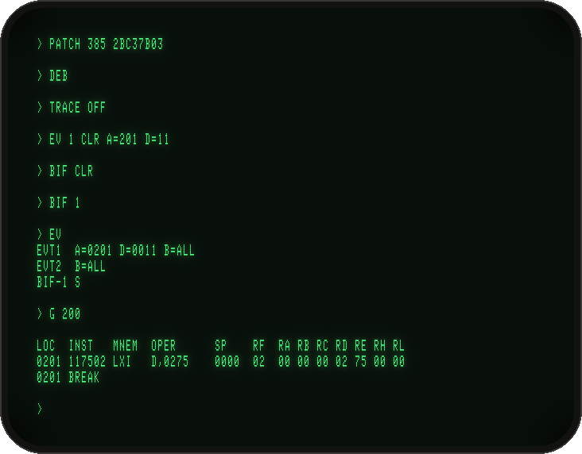
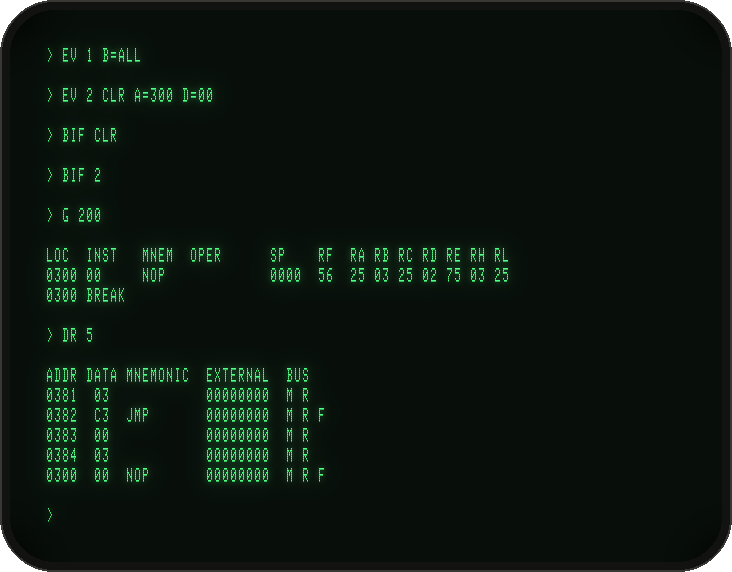
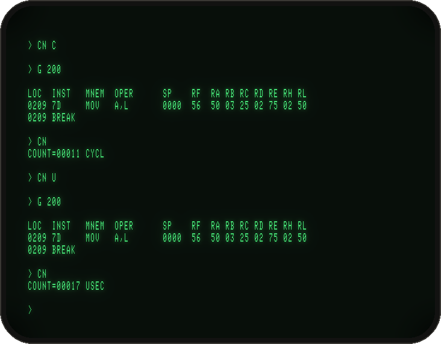
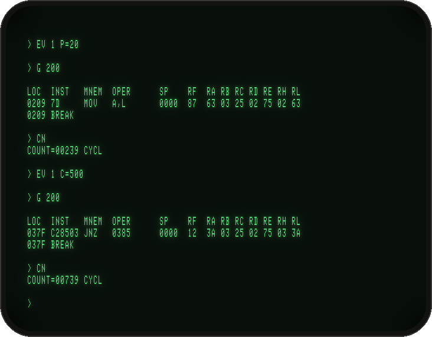
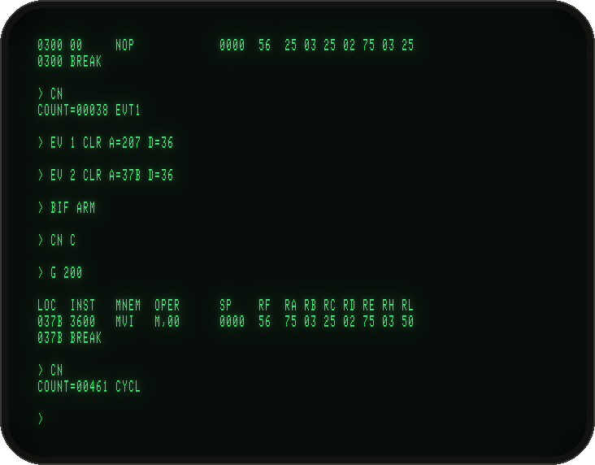
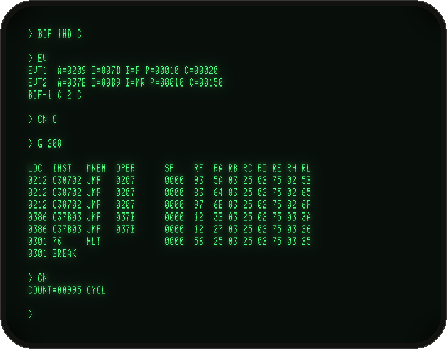
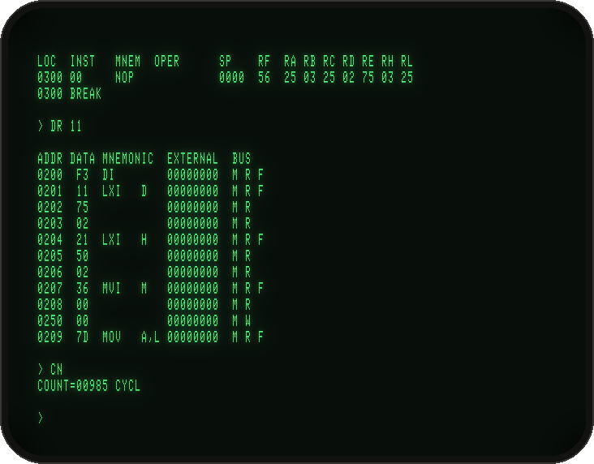
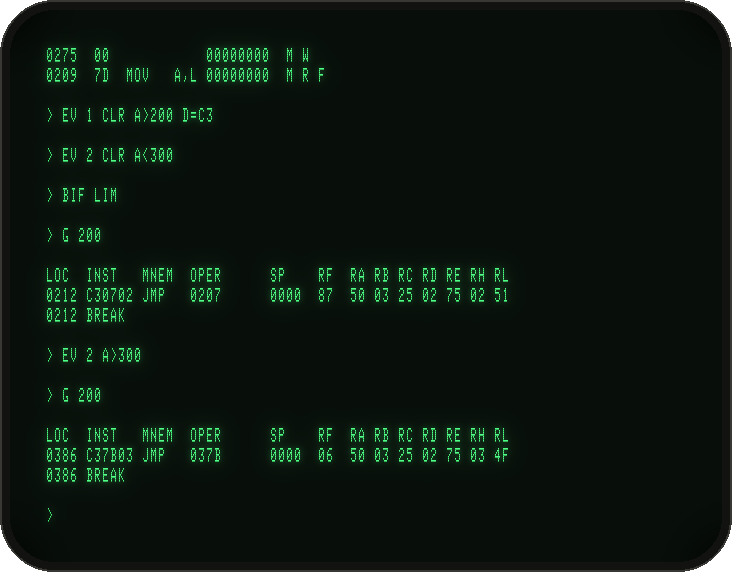

# Analysing programs with the Real-Time Prototype Analyzer

The **Real-Time Prototype Analyzer** (RTPA, 1977) was the 8001/8002's hardware debugging option: one board in the mainframe, wired to the bus of the emulator processor that runs your program. It watches every bus cycle at full speed, without slowing the program down. With it you can:

- **stop on an event**: an address (equal, below, above), a data value, a kind of bus cycle (fetch, memory read or write, I/O), a pattern on the probe's eight clips, or two events combined;
- **count** passes before stopping ("the 20th time"), or **delay** the stop by a number of bus cycles, fetches, clocks or microseconds;
- **measure** what happens between two events: bus cycles, processor clocks, microseconds or milliseconds;
- **record** the last 128 bus transactions, all of them or only fetches, reads, writes or I/O, and list them with the opcodes decoded.

TEKDOS's own `BKPT` stops on two addresses. The RTPA stops on conditions, and shows what led up to them.

This tutorial follows Tektronix's **RTPA users guide** (070-2785, 1979), §3, "How to use the RTPA commands". Its seven procedures run an 8080 sample program, and print what a real 8002A displayed at each step. The emulator reproduces those displays: every bus-cycle count and break line below is the guide's, checked by `tests/rtpa_guide.sh` (81 checks). Microsecond counts may differ by one or two, as the guide itself says they do between runs. How the board works is in [notes/rtpa.md](../notes/rtpa.md).

**Contents:** [1. Start the lab](#1-start-the-lab) · [2. The sample program](#2-the-sample-program) · [3. Stop on an event](#3-stop-on-an-event) · [4. Look back: the trace](#4-look-back-the-trace) · [5. Count and time](#5-count-and-time) · [6. Pass counts and delays](#6-pass-counts-and-delays) · [7. Count loop passes](#7-count-loop-passes) · [8. Measure between two events: ARM](#8-measure-between-two-events-arm) · [9. Watch without stopping](#9-watch-without-stopping) · [10. Freeze the trace: FRZ](#10-freeze-the-trace-frz) · [11. Limits: LIM](#11-limits-lim) · [12. Before, around or after the event](#12-before-around-or-after-the-event) · [Command reference](#command-reference) · [In the emulator](#in-the-emulator)

## 1. Start the lab

Fit the RTPA with `-rtpa`, on a copy of the TEKDOS 8080 system disc (the guide's program is 8080 code):
```
make -C emu
cp sources/bitsavers/disks/Tek8002_Belgium_Amusements/Tek8002_3.img /tmp/tek8080.img
emu/build/tek8002 -rtpa -0 /tmp/tek8080.img          # or emu/build/tek8002-gui -rtpa ...
```
TEKDOS takes upper case only. Three of the RTPA commands, `BIF`, `RTT` and `DRT`, work only in the **debug system**; elsewhere they answer with error 03. So, after loading the program, enter `DEB`, and turn the debug trace off as the guide does: `TRACE OFF`. Every command has a short form: `EV` for `EVT`, `CN` for `CNT`, `RT` for `RTT`, `DR` for `DRT`, `G` for `GO`.

## 2. The sample program

The guide's program clears 0250–0275, then 0350 down to 0325, and halts:

| Address | Bytes | 8080 | |
|---|---|---|---|
| 0200 | F3 | DI | START |
| 0201 | 11 75 02 | LXI D,0275 | end of the first area |
| 0204 | 21 50 02 | LXI H,0250 | start of the first area |
| 0207 | 36 00 | MVI M,0 | LOOP1: clear a byte |
| 0209 | 7D | MOV A,L | |
| 020A | BB | CMP E | reached 75? |
| 020B | C2 11 02 | JNZ 0211 | no: go on |
| 020E | C3 75 03 | JMP 0375 | yes: the second area |
| 0211 | 23 | INX H | |
| 0212 | C3 07 02 | JMP 0207 | |
| 0375 | 01 25 03 | LXI B,0325 | |
| 0378 | 21 50 03 | LXI H,0350 | |
| 037B | 36 00 | MVI M,0 | LOOP2 |
| 037D | 7D | MOV A,L | |
| 037E | B9 | CMP C | reached 25? |
| 037F | C2 85 03 | JNZ 0385 | |
| 0382 | C3 00 03 | JMP 0300 | |
| 0385 | 2B | DCX H | |
| 0386 | C3 7B 03 | JMP 037B | |
| 0300 | 00 | NOP | the last RTPA breakpoint |
| 0301 | 76 | HLT | |

Fill the area with FF first, so that the zeros show, and patch the program in (the guide loads it from a disc file, RTPA4, which does not survive; the bytes are its Fig. 3-1):
```
> F 200 400 FF
> PATCH 200 F311750221500236007DBBC21102C37503
> PATCH 211 23C30702
> PATCH 300 0076
> PATCH 375 01250321500336007DB9C28503C30003
> PATCH 385 2BC37B03
> DEB
> TRACE OFF
```
Each pass of LOOP1 or LOOP2 is 6 instructions and **12 bus cycles**. LOOP1 runs 38 times, LOOP2 44 times.

## 3. Stop on an event

An **event** is a condition on one bus cycle. Event 1: address 0201, data 11 (the `LXI D` opcode). `BIF` (breakpoint, "break if") says which events stop the program:
```
> EV 1 CLR A=201 D=11
> BIF CLR
> BIF 1
> EV
EVT1  A=0201 D=0011 B=ALL
EVT2  B=ALL
BIF-1 S
> G 200
LOC  INST   MNEM  OPER      SP    RF  RA RB RC RD RE RH RL
0201 117502 LXI   D,0275    0000  02  00 00 00 02 75 00 00
0201 BREAK
```


*`EV` shows the setting; `G 200` stops after `LXI D`.*

The program stopped **after** the instruction whose cycle matched: `LXI D` has run (DE = 0275). `S` in `BIF-1 S` means stop; section 9 shows the other choice.

`B=` restricts the kind of bus cycle: `F` fetch, `MR`/`MW` memory read/write, `IR`/`IW` I/O, `W` any write, `ALL`. With `EV 1 B=F` the result is the same: 0201 is an opcode fetch. With `EV 1 B=W` nothing matches, since nobody writes to 0201, and the program runs on to its halt:
```
> EV 1 B=W
> G 200
0301 76     HLT             0000  56  25 03 25 02 75 03 25
0301 BREAK
```
Event 2 works the same way. Break on the `NOP` at the end (`EV 1 B=ALL` first, to undo the `W`):
```
> EV 2 CLR A=300 D=00
> BIF CLR
> BIF 2
> G 200
0300 00     NOP             0000  56  25 03 25 02 75 03 25
0300 BREAK
```

## 4. Look back: the trace

All the while, the RTPA recorded the bus transactions. `DR n` lists the last n:
```
> DR 5
ADDR DATA MNEMONIC  EXTERNAL  BUS
0381  03            00000000  M R
0382  C3  JMP       00000000  M R F
0383  00            00000000  M R
0384  03            00000000  M R
0300  00  NOP       00000000  M R F
```


*Event 2 stops on the `NOP` at 0300; `DR 5` shows the `JMP 0300` that led there.*

The way into 0300: the `JMP 0300` at 0382, its two address bytes, then the fetch at 0300. The bus column is **M**emory or **I**/O, **R**ead or **W**rite, **F**etch. EXTERNAL is the probe's eight clips (none connected here).

`RT` chooses what is stored. With only fetches, the same five lines reach further back:
```
> EV 2 B=F
> RT F
> G 200
> DR 5
037D  7D  MOV   A,L 00000000  M R F
037E  B9  CMP   C   00000000  M R F
037F  C2  JNZ       00000000  M R F
0382  C3  JMP       00000000  M R F
0300  00  NOP       00000000  M R F
```
`RT ALL` stores everything again.

## 5. Count and time

The RTPA's **general-purpose counter** counts from the start of the run (`G`) to the break. `CN` chooses what it counts and shows the result. Back to event 1 at the `MOV A,L` in LOOP1:
```
> EV CLR
> EV 1 A=209 D=7D B=F
> BIF 1
> CN C
> G 200
0209 7D     MOV   A,L       0000  56  50 03 25 02 75 02 50
0209 BREAK
> CN
COUNT=00011 CYCL
> CN U
> G 200
> CN
COUNT=00017 USEC
```


*From `G` to the break at 0209: 11 bus cycles, then the same run timed in microseconds.*

**11 bus cycles**: DI (1), LXI D (3), LXI H (3), MVI M (3), and the fetch at 0209. The guide shows the same 11 and 17 µs. The 8080 board runs at 3 MHz and adds one wait state to every memory cycle, so these 49 clocks take 16.3 µs; the counter's 1 µs clock runs freely, so it reads 16 or 17 depending on where it stands when the run starts.

The counter's units: `F` fetches, `C` bus cycles, `E` emulator clocks, `U` microseconds, `M` milliseconds, `T` trace stores, `1`/`2` occurrences of event 1/2.

## 6. Pass counts and delays

`P=n` waits for the n-th occurrence of the event:
```
> EV 1 P=2
> CN C
> G 200
0209 7D     MOV   A,L       0000  87  51 03 25 02 75 02 51
0209 BREAK
> CN
COUNT=00023 CYCL
> EV 1 P=20
> G 200
> CN
COUNT=00239 CYCL
```
One pass of LOOP1 is 23 − 11 = **12 bus cycles**, so the 20th occurrence comes at 11 + 19 × 12 = **239**, as the guide computes. L counts the passes (51 is the second).

`C=n` **delays** the break by n units of whatever `CN` counts, here bus cycles. 500 cycles after the 20th pass:
```
> EV 1 C=500
> G 200
037F C28503 JNZ   0385      0000  12  3A 03 25 02 75 03 3A
037F BREAK
> CN
COUNT=00739 CYCL
```


*The 20th pass at 239 cycles; with `C=500` the break comes 500 cycles later, at 037F in LOOP2.*

239 + 500 = **739**, and by then the program is in LOOP2. The delay unit follows `CN`: after `CN U`, `C=20` means 20 µs.

Event 2 has its own pass count and delay. On the memory read of `CMP C` in LOOP2:
```
> EV 2 A=37E D=B9 B=MR
> BIF CLR
> BIF 2
> G 200
037E B9     CMP   C         0000  06  50 03 25 02 75 03 50
037E BREAK
> CN
COUNT=00473 CYCL
> EV 2 P=10
> G 200
> CN
COUNT=00581 CYCL
```
473 + 9 × 12 = **581**.

## 7. Count loop passes

`CN 1` counts the occurrences of event 1. Put event 1 inside a loop and event 2 after it:
```
> EV 1 CLR A=207 D=36
> EV 2 CLR A=300 D=00
> CN 1
> G 200
0300 00     NOP             0000  56  25 03 25 02 75 03 25
0300 BREAK
> CN
COUNT=00038 EVT1
```
LOOP1 ran **38** times (0250 to 0275). With event 1 in LOOP2 (`EV 1 CLR A=37B D=36`), it shows **44**. An event counts even when it is not allowed to break: with `BIF` cleared (`EV CLR` does that too; `EV` then shows `IND`), `CN 1` and `CN 2` count both loops in one run each, and the program stops only at its halt.

## 8. Measure between two events: ARM

`BIF ARM` makes event 1 **arm** event 2: event 2 counts only after event 1 has happened, and the counter counts only while armed. That measures the time between two points of a program:
```
> EV 1 CLR A=207 D=36
> EV 2 CLR A=37B D=36
> BIF ARM
> CN C
> G 200
037B 3600   MVI   M,00      0000  56  75 03 25 02 75 03 50
037B BREAK
> CN
COUNT=00461 CYCL
```


*461 bus cycles from LOOP1's first `MVI` to LOOP2's.*

From the first `MVI` of LOOP1 to the first of LOOP2: **461** bus cycles. With `EV 1 P=10` the measurement starts at the 10th pass (**353**), and with `EV 2 P=20` it ends at LOOP2's 20th (**581**).

Two rules the guide points out:
- **A delay on event 1 never runs out under ARM** ("an EVT1 trigger cannot be generated"): with `EV 1 C=100`, the program runs to its halt and the count stays 0. A delay on event 2 works (`EV 2 C=100`: 681).
- **Event 2 must come after event 1, not with it.** With both events on 0207, the break comes on the **next** pass, 12 cycles later:
```
> EV 1 CLR A=207 D=36
> EV 2 CLR A=207 D=36
> G 200
0207 3600   MVI   M,00      0000  87  50 03 25 02 75 02 51
0207 BREAK
> CN
COUNT=00012 CYCL
> DR 25
ADDR DATA MNEMONIC  EXTERNAL  BUS
0207  36  MVI   M   00000000  M R F
0208  00            00000000  M R
0251  00            00000000  M W
0200  F3  DI        00000000  M R F
0201  11  LXI   D   00000000  M R F
...
```
`DR 25` shows the whole run: the start of the program, the arming pass, and the pass that broke.

## 9. Watch without stopping

The return option `C` (continue) makes a break print its line and go on. `BIF IND` lets either event break. Each event with a pass count of 10 and a delay:
```
> EV 1 CLR A=209 D=7D B=F P=10 C=20
> EV 2 CLR A=37E D=B9 B=MR P=10 C=150
> BIF IND C
> EV
EVT1  A=0209 D=007D B=F P=00010 C=00020
EVT2  A=037E D=00B9 B=MR P=00010 C=00150
BIF-1 C 2 C
> CN C
> G 200
0212 C30702 JMP   0207      0000  93  5A 03 25 02 75 02 5B
0212 C30702 JMP   0207      0000  83  64 03 25 02 75 02 65
0212 C30702 JMP   0207      0000  97  6E 03 25 02 75 02 6F
0386 C37B03 JMP   037B      0000  12  3B 03 25 02 75 03 3A
0386 C37B03 JMP   037B      0000  12  27 03 25 02 75 03 26
0301 76     HLT             0000  56  25 03 25 02 75 03 25
0301 BREAK
> CN
COUNT=00995 CYCL
```


*Three event 1 lines in LOOP1, two event 2 lines in LOOP2, and the program runs on to its halt.*

These are the guide's lines exactly. Event 1 fires every 10th pass of LOOP1 (L = 5A, 64, 6E), 20 cycles after its event. Event 2's delay of 150 cycles is longer than 10 passes, so the 20th pass comes while it is still running and is ignored: it fires after the 10th and the 30th passes only.

## 10. Freeze the trace: FRZ

`BIF FRZ` is ARM, plus: **the trace stops recording at event 1**. What led up to event 1 is kept, however long the program runs before event 2:
```
> EV 1 CLR A=209 D=7D
> EV 2 CLR A=300 D=00
> BIF FRZ
> CN C
> G 200
0300 00     NOP             0000  56  25 03 25 02 75 03 25
0300 BREAK
> DR 11
ADDR DATA MNEMONIC  EXTERNAL  BUS
0200  F3  DI        00000000  M R F
0201  11  LXI   D   00000000  M R F
0202  75            00000000  M R
0203  02            00000000  M R
0204  21  LXI   H   00000000  M R F
0205  50            00000000  M R
0206  02            00000000  M R
0207  36  MVI   M   00000000  M R F
0208  00            00000000  M R
0250  00            00000000  M W
0209  7D  MOV   A,L 00000000  M R F
> CN
COUNT=00985 CYCL
```


*The program ran on to 0300, but the trace ends at 0209, where event 1 froze it.*

The trace ends at 0209, event 1, though the program ran on for 985 cycles to 0300.

With `BIF FRZ C`, event 2 prints, **disarms**, and lets the trace run again until event 1 comes back. With event 1 at 0209 and event 2 at 0212, both in LOOP1, that happens on every pass, and the trace keeps the stretch from each event 2 to the next event 1:
```
> EV 1 CLR A=209 D=7D
> EV 2 CLR A=212 D=C3
> BIF FRZ C
> G 200
0212 C30702 JMP   0207      0000  87  50 03 25 02 75 02 51
0212 C30702 JMP   0207      0000  83  51 03 25 02 75 02 52
0212 C30702 JMP   0207      0000  87  52 03 25 02 75 02 53
...
0301 BREAK
> DR 30
...
0207  36  MVI   M   00000000  M R F
0208  00            00000000  M R
0274  00            00000000  M W
0209  7D  MOV   A,L 00000000  M R F
0207  36  MVI   M   00000000  M R F
0208  00            00000000  M R
0275  00            00000000  M W
0209  7D  MOV   A,L 00000000  M R F
```
(On the real lab you press ESC after a few lines; the emulator lets it run to the halt.)

## 11. Limits: LIM

`BIF LIM` breaks when event 1 happens **within event 2's limits**. Event 2 lends only its address and bus type; its data, pass count and delay are ignored. Break on the first `JMP` (data C3) above 0200 and below 0300:
```
> EV 1 CLR A>200 D=C3
> EV 2 CLR A<300
> BIF LIM
> G 200
0212 C30702 JMP   0207      0000  87  50 03 25 02 75 02 51
0212 BREAK
```
Move the window above 0300 (`EV 2 A>300`), and the first `JMP` there is LOOP2's:
```
0386 C37B03 JMP   037B      0000  06  50 03 25 02 75 03 4F
0386 BREAK
```


*The first `JMP` below 0300 is at 0212; with the window above 0300, LOOP2's at 0386.*

Event 1's pass count and delay work under LIM: with event 1 at 0209 and event 2 `A<37E`, `EV 1 P=5` breaks after 59 cycles, and `C=10` more after 69. Event 2's pass count and delay change nothing.

## 12. Before, around or after the event

The trace holds 128 transactions. Where the event falls in them depends on when you stop:
- **pre-trigger**: break on the event, and the trace shows what led to it;
- **centre**: delay the break by 64 cycles, and the event is in the middle;
- **post-trigger**: delay it by 128, and the trace shows what followed.
```
> EV 1 CLR A=200 C=128
> CN C
> BIF CLR
> BIF 1
> G 200
0207 3600   MVI   M,00      0000  97  59 03 25 02 75 02 5A
0207 BREAK
> DR *
ADDR DATA MNEMONIC  EXTERNAL  BUS
0202  75            00000000  M R
0203  02            00000000  M R
0204  21  LXI   H   00000000  M R F
...
```
`DR *` lists all 128. They start just after the event at 0200, which has scrolled out.

## Command reference

| Command | |
|---|---|
| `EV n A=aaaa D=dd B=t T=bbbbbbbb P=n C=n` | set event n (1 or 2): address `A=` equal, `A<` at most, `A>` at least; data; bus type `F`, `MR`, `MW`, `IR`, `IW`, `R`, `W`, `ALL`; probe pattern (1, 0 or X per clip); pass count; delay |
| `EV n CLR`, `EV CLR`, `EV` | clear an event; clear both and BIF; display |
| `BIF 1`, `2`, `IND`, `ARM`, `FRZ`, `LIM`, `CLR` | which events break; append `C` per event to continue after printing (`BIF IND C`, `BIF 1 C`) |
| `CN x` | count `F` fetches, `C` bus cycles, `E` clocks, `U` µs, `M` ms, `T` trace stores, `1`/`2` events; also the unit of every delay. `CN` alone shows the count |
| `RT x` | store `ALL`, `F`, `MR`, `MW`, `IR`, `IW`, ... |
| `DR n`, `DR *` | list the last n, or all 128, stored transactions |

## In the emulator

- **Options:** `-rtpa` fits the board; `-rtpa probe` loops the probe back to A0–A7 (a diagnostic fixture). The probe cannot be fed from outside yet.
- **Timing:** the 8080 board runs at 3 MHz with one wait state per memory cycle, the Z80 board at 4 MHz with two, the 6800 at 1 MHz with none, as the guide's Appendix A gives them; the analyzer counts them cycle by cycle. On the 6800 the page FE00–FEFF is I/O, and an access to its SVC window takes one clock more (inferred from Millennium's analyzer test).
- **The pictures** are made by `tools/make_rtpa_shots.sh` from a scripted run of this session (the commands above, in order), so they come out the same on every run.
- **Trace of a run:** `TEK_RTPATRACE=1` logs every register access, match and break on stderr.
- **Known differences** from the real lab (`notes/rtpa.md`, "Open"): microsecond delays can expire one instruction early; the trace before a program does not show the board firmware's last fetch.
- **The same session on the 8550:** the sibling 8550 emulator has the same board, under DOS/50 (`../tektronix-8550-emulator/docs/RTPA.md`).
