# Tutorials

Short recipes, a few minutes each. Every one is a command sequence from the session tests in `tests/`, run on the emulator, and every picture is the emulated CT8100's screen at that point (made by `tools/make_screenshots.sh` and `tools/make_tutorial_shots.sh`). For the long tour (every option, the monitor, discs, TEKDOS, debugging) see [OPERATION.md](OPERATION.md). Commands run from the repository root, after `make -C emu`.

1. [Boot and LDIR](#1-boot-and-ldir)
2. [Tektronix's Z80 DEMO: assemble, run, trace, debug](#2-tektronixs-z80-demo-assemble-run-trace-debug)
3. [The same on the 6800](#3-the-same-on-the-6800)
4. [ASM and LINK on the Assembler Processor](#4-asm-and-link-on-the-assembler-processor)
5. [The printer and paper tape ports](#5-the-printer-and-paper-tape-ports)
6. [Format a disc and duplicate the system disc](#6-format-a-disc-and-duplicate-the-system-disc)
7. [Modes 1 and 2 against a prototype](#7-modes-1-and-2-against-a-prototype)
8. [A ZX Spectrum as the prototype](#8-a-zx-spectrum-as-the-prototype)
9. [Scripted, headless runs](#9-scripted-headless-runs)

---

## 1. Boot and LDIR

```
make -C emu gui
cd emu
build/tek8002-gui -0 ../sources/bitsavers/disks/TekDOS_3.3_6800_cpy1.img
```
Three windows open: the CT8100, and the front panels of the 8002A mainframe and the Flexible Disc Unit.

What happens:
1. **Power-up:** the 2650 runs the bootstrap PROM, which asks the disc unit for tracks 1–4 of drive 0. The disc controller runs its own microprogram and reads the sectors at the real 360 rpm; drive 0's busy light (a small dot on the door, an emulator aid) is lit.
2. **About 12 s:** the 16K of TEKDOS is in memory, and the banner and the `>` prompt appear.

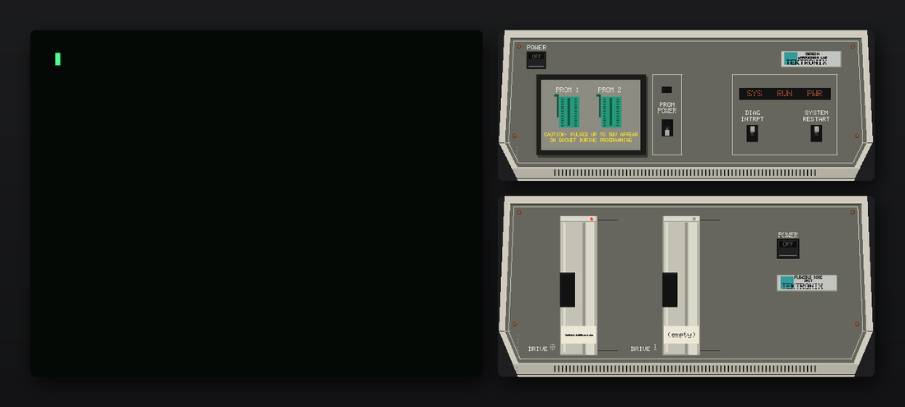
*Four seconds in: the screen is still blank; drive 0 is busy. SYS, RUN and PWR are lit: the 2650 is the bus master, and it runs. The lamps follow the service manual's schematics (`notes/8002.md`).*

Click into the terminal and type `ldir` and Return. TTY LOCK is down by default, so TEKDOS receives `LDIR`; TEKDOS takes upper case only.

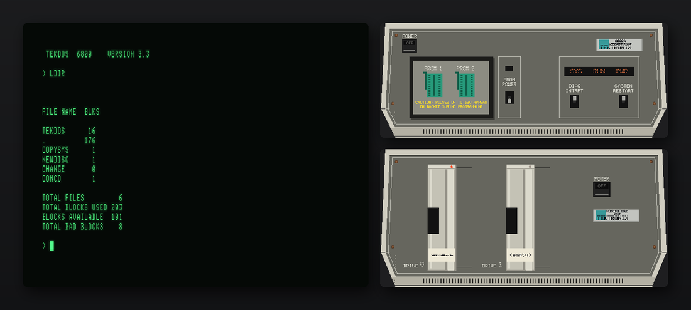
*The directory of the TEKDOS 3.3 system disc: TEKDOS itself, "." (the overlays: ASM, LINK, DEBUG…), COPYSYS and NEWDISC, and two more files.*

The same in your terminal: `build/tek8002 -0 ../sources/bitsavers/disks/TekDOS_3.3_6800_cpy1.img`, and Ctrl-] then `q` to quit.

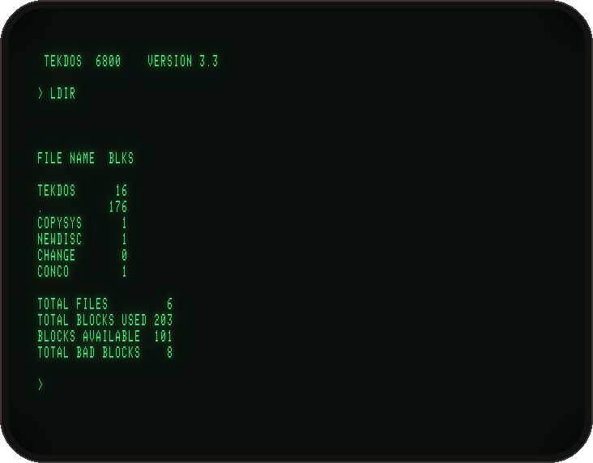

## 2. Tektronix's Z80 DEMO: assemble, run, trace, debug

The Z80 system disc from the Belgian collection (`Tek8002_10`, TEKDOS Z80 3.1) carries Tektronix's own demonstration program, `DEMO%S`. ASM and LINK write files, so work on a copy, with `-rw`:
```
cp sources/bitsavers/disks/Tek8002_Belgium_Amusements/Tek8002_10.img disks/z80.img
emu/build/tek8002 -rw -0 disks/z80.img
```

Look at it, then assemble, link, load and run it:
```
> COPY DEMO%S CONO
       TITLE   "Z80 DEMONSTRATION RUN PROGRAM"
       ORG     100H            ; START PROGRAM AT ADDRESS 100
DEMO   LD      HL,500H         ; SET TABLE POINTER
       LD      B,5             ; SET PASS COUNTER
       XOR     A               ; CLEAR ACCUMULATOR
LOOP   ADD     A,(HL)          ; ADD BYTE FROM TABLE
       INC     HL              ; POINT TO NEXT BYTE
       DEC     B               ; DECREMENT PASS COUNTER
       JP      NZ,LOOP         ; 5 PASSES? NO? DO IT AGAIN
       OUT     (0F7H),A        ; IF 5 PASSES,
       NOP                     ;    EXIT FROM USER PROGRAM
       ORG     40H             ; SET UP SERVICE CALL
       WORD    4200H           ;    THAT TELLS TEKDOS
       BYTE    1AH             ;    TO EXIT FROM USER PROGRAM
       END     DEMO            ; END OF SOURCE CODE FILE
*COPY* EOJ
> ASM DEMO;O DEMO;A DEMO%S          object, listing, source
> LINK DEMO;L DEMO;K DEMO;O         load module, link listing, object
> LOAD DEMO;L
> PATCH 500 0102030405              the table it adds up
> GO 100
> DUMP 500 50F
```

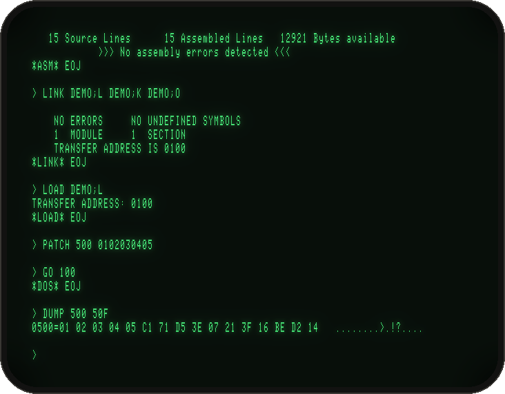
*ASM and LINK run on the Z80 Assembler Processor; GO runs the DEMO on the Z80 Emulator Processor. `*DOS* EOJ` is the program's exit: `OUT (0F7H),A` is SVC 1, and its request block at 0040 (function 1A) asks TEKDOS to end the program.*

**Trace it.** Enter the debug system, turn on tracing, run:
```
> DEBUG
> TRACE ALL
> GO 100
```
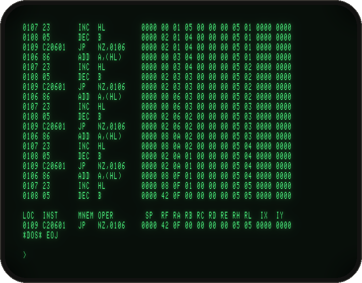
*Each line is one instruction and the registers after it: SP, then F A B C D E H L, IX, IY. A builds up 01, 03, 06, 0A, 0F while B counts down; at B = 0 the Z flag (F = 42) ends the loop.*

The program's exit also ends DEBUG. A debug command after `*DOS* EOJ` gives ERROR 03, so type `DEBUG` again each time.

**Breakpoint, registers, single steps.** Load it again and stop it at DEC B, the sixth instruction it runs:
```
> LOAD DEMO;L
> PATCH 500 0102030405
> DEBUG
> BKPT 0108 R              break when 0108 is read: when DEC B is fetched
> GO 100
> DSTAT                    every register
> SET RA 77                A = 77
> TRACE ALL STEP           stop after each instruction
> GO
> GO
```
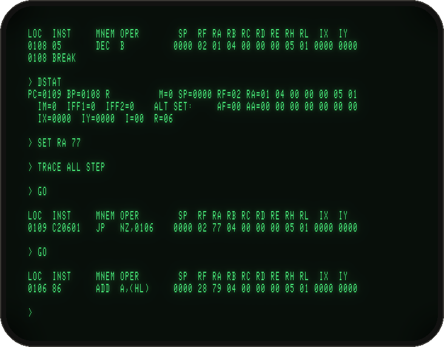
*The break comes after DEC B (PC=0109). DSTAT shows the main set, IM and the IFFs, the alternate set, IX, IY, I and R. After `SET RA 77` each `GO` runs one instruction: JP NZ, then ADD A,(HL) makes A = 77 + 2 = 79.*

`ABORT DEBUG` leaves the debug system. Try a HALT where the SVC was (`PATCH 10C 76`): `GO 100` ends in `*DOS* ERROR 46`, "emulator halted", and under DEBUG it is a break at the HALT.

## 3. The same on the 6800

The 6800 system disc has no demo program, so this uses the one the 6800 test runs, `tests/data/run68.s`: it adds up the bytes of a message, prints the message by SVC, and exits by SVC. Put it on a copy of the disc with `../tekmato`:
```
cp sources/bitsavers/disks/TekDOS_3.3_6800_cpy1.img disks/m68.img
../tekmato/tekmato -open disks/m68.img -write tests/data/run68.s 'RUN68;S' text -save
emu/build/tek8002 -rw -0 disks/m68.img
> ASM RUN68;O RUN68;A RUN68;S
> LINK RUN68;L RUN68;K RUN68;O
> ASSIGN 1 CONO              the program writes to channel 1
> LOAD RUN68;L
> GO 300
HELLO FROM THE 6800
*DOS* EOJ
> DUMP 32E 32F               its sum, C4 04, at 032E
```
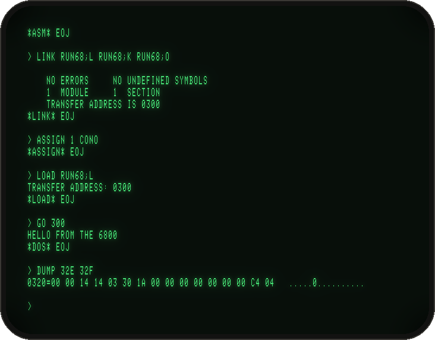
*The 6800's SVCs are memory-mapped: `STA A 0FEF7H` is SVC 1, which writes the message, and `STA A 0FEF6H` SVC 2, which exits. The request blocks' addresses are at 0040.*

Traced, with `DEBUG`, `TRACE ALL`, `GO 300` (after `ASSIGN 1 CONO` and `LOAD RUN68;L`):

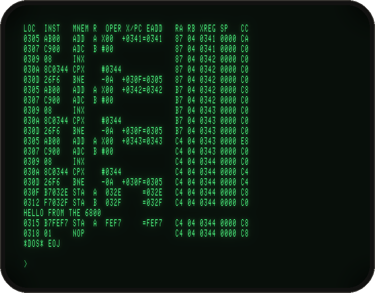
*The 6800 trace line: the instruction, its effective address (`X/PC EADD`), then A, B, X, SP and CC. The last line is the SVC store to FEF7.*

And a breakpoint, a register change and a step:
```
> DEBUG
> BKPT 030F R
> GO 300                     030F BREAK
> DSTAT
> SET RA 11 22               A = 11, B = 22
> TRACE ALL STEP
> GO                         STA B 032F stores the new B
> ABORT DEBUG
> DUMP 32E 32F               C4 22
```
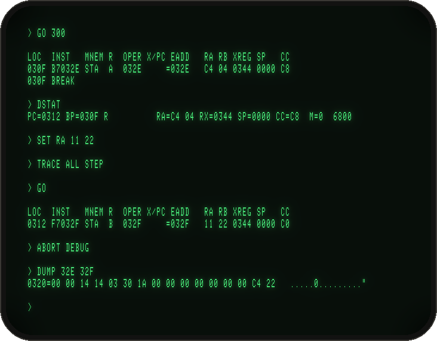
*DSTAT names the processor (6800; a 6802 would show as 6802) and the emulation mode. The SET reached memory: 032F now holds 22.*

## 4. ASM and LINK on the Assembler Processor

ASM, LINK and the macro processor do not run on the 2650. They run on the **Assembler Processor**, a Z80 board that TEKDOS loads the tool into and starts as a slave; the tool asks TEKDOS for its files by SVCs. A small 6800 module, `tests/data/hello.s`:
```
cp sources/bitsavers/disks/TekDOS_3.3_6800_cpy1.img disks/asm.img
../tekmato/tekmato -open disks/asm.img -write tests/data/hello.s 'HELLO;S' text -save
emu/build/tek8002 -rw -0 disks/asm.img
> ASM HELLO;O HELLO;A HELLO;S
> LINK HELLO;L HELLO;K HELLO;O
```
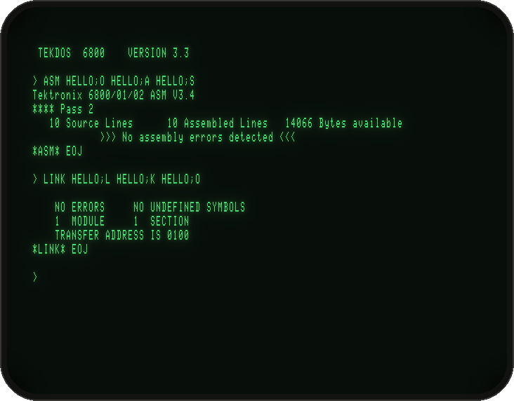
*Tektronix's 6800/01/02 assembler V3.4 and the linker, both running on the Z80. About 120 SVCs serve a 10-line module.*

```
> COPY HELLO;A CONO
```
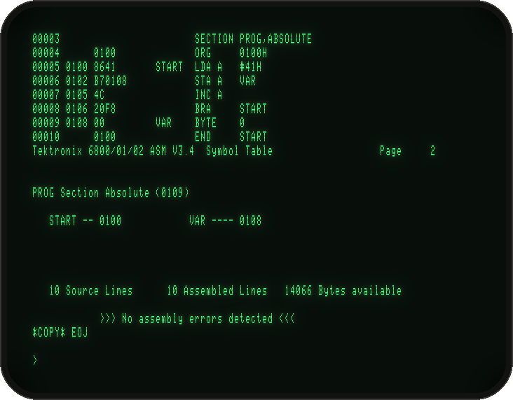
*The listing: 6800 code (86 41 for LDA A #41H), and the symbol table.*

## 5. The printer and paper tape ports

Connect the line printer and paper tape ports to files, and print to them:
```
emu/build/tek8002 -0 sources/bitsavers/disks/TekDOS_3.3_6800_cpy1.img -1 sources/bitsavers/disks/Tek8002_Belgium_Amusements/Tek8002_1a.img \
    -lpt file:printer.txt -rem file:modem.txt -ppt file:tape.txt
> LDIR 0 LPT1                the directory, to the line printer
> COPY V;S/1 REMO            a source file from drive 1, out of the modem port
> COPY V;S/1 PPTP            the same file, punched on paper tape
```
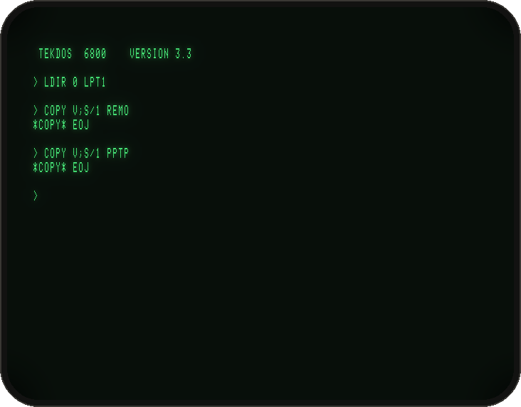
*Nothing on the console but the commands: the output went to the ports.*

`printer.txt` now holds the directory listing, and `modem.txt` and `tape.txt` the source file, byte for byte:
```
	TITLE	"680X VECTORS"
	STITLE	"MODULE : V680X.   SECTION : V680X    FILE :V680X%."
	GLOBAL	IRQV,NMIV,RESV,SWIV
...
```
Instead of `file:`, give `tcp:HOST:PORT`, `listen:PORT` or `unix:PATH` to connect a program, or `loop` for a wrap-back plug.

## 6. Format a disc and duplicate the system disc

`new:FILE` puts a never-formatted disc in a drive, with no flux at all. FORMAT writes every sector through the real disc controller; DUP copies every file onto it.
```
cp sources/bitsavers/disks/TekDOS_3.3_6800_cpy1.img disks/work.img
emu/build/tek8002 -rw -0 disks/work.img -1 new:disks/backup.img
> FORMAT 1 SCRATCH
> DUP 0 1 BACKUP             every file of drive 0, and the disc renamed BACKUP
> LDIR 1
```
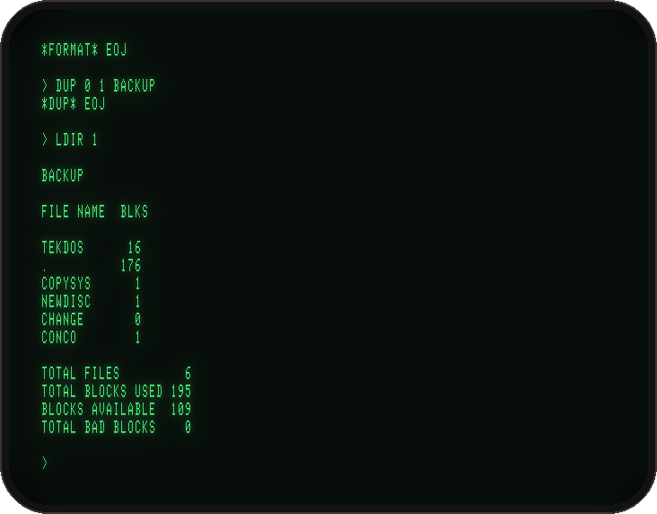
*The copy: the same six files. It has no bad blocks; the original system disc has eight.*

This takes about 15 minutes of machine time at the real disc speed; a batch run (stdin not a terminal) takes under a minute. With `-rw`, `disks/backup.img` is saved on exit. Check it with `../tekmato/tekmato -open disks/backup.img -check -info`:
```
I : volume is consistent
  Format         tkdos-sssd: 77 tracks, 32 hard sectors of 128 bytes, single sided
  Disc name      BACKUP
```
`COPYSYS 0 1` instead copies only the system (TEKDOS, ".", COPYSYS, NEWDISC), which makes the disc bootable. A FORMAT of a `new:` disc leaves an image byte-identical to the real formatted disc `Tek8002_1b` from the collection (`tests/disc_tools.sh` checks it).

## 7. Modes 1 and 2 against a prototype

In modes 1 and 2 the emulator board runs in your own hardware, the prototype. Here the prototype is `tools/proto_target.py`, a program with 64 KB of RAM and a console UART at ports 10h (data) and 11h (status), reached over a socket.

```
python3 tools/proto_target.py --tcp 18002                                  # terminal 1
cp sources/bitsavers/disks/Tek8002_Belgium_Amusements/Tek8002_10.img disks/z80.img
emu/build/tek8002 -target tcp:127.0.0.1:18002 -rw -0 disks/z80.img          # terminal 2
```

**Mode 1:** program memory stays in the 8002, I/O goes to the prototype, and blocks you map U go there too.
```
> EMULATE 1
> PATCH 100 2120017EB72805D3102318F776     print the string at 0120 to port 10h, then HALT
> PATCH 120 48490D00                       "HI", CR
> GO 100                                   "HI" appears in terminal 1
*DOS* ERROR 46                             the HALT (TEKDOS turns SVCs off in modes 1/2)
> EMULATE 1                                ERROR 46 put TEKDOS back in mode 0
> MAP U 8000-80FF                          8000-80FF is the prototype's
> MAP R
> PATCH 200 3E5A32008076                   LD A,5A / LD (8000),A / HALT
> GO 200
> MOVE UP 8000 8003 300                    prototype memory to program memory
> DUMP 300 30F
```
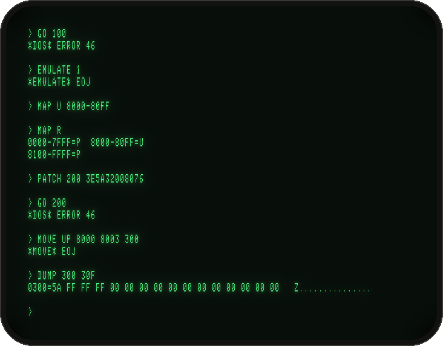
*The store to 8000 went to the prototype; MOVE UP brought it back (5A), with FF where the prototype's RAM was never written.*

**Mode 2:** everything is the prototype's. PATCH writes into its memory, and the program runs from there, traced:
```
> EMULATE 2
> PATCH 100 2120017EB72805D3102318F776
> PATCH 120 4D4F444520320D00               "MODE 2", CR
> DUMP 100 12F                             read back from the prototype
> DEBUG
> TRACE ALL
> GO 100                                   "MODE 2" appears in terminal 1
```
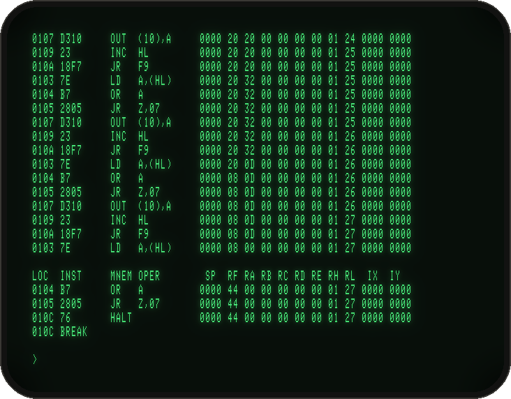
*Every fetch, read and write of the program, and its OUT (10),A, went over the link. Run the target with `--log` to see them: `[F 0100 00 -> 21]` is the first fetch.*

With `--clock 2` the prototype reports a 2 MHz clock (link version 4), and in modes 1 and 2 the board runs at it, as a real probe takes the prototype's clock. The protocol is in [INTEGRATION.md §1](INTEGRATION.md#1-the-prototype-link).

## 8. A ZX Spectrum as the prototype

FUSE, the Spectrum emulator, has a branch that speaks the prototype link: its `--tek-probe` option makes a ZX Spectrum 48K the prototype, listening on tcp:127.0.0.1:18550 (the TC3256 EMUL repository, branch `feature/tek8550-probe`, first written for the sibling 8550 emulator). The 8002's Z80 board runs the Spectrum's own ROM:
```
./fuse --machine 48 --tek-probe                                   # the Spectrum
emu/build/tek8002 -target tcp:127.0.0.1:18550 -0 disks/z80.img     # the Z80 system disc
[prototype link: protocol v4, clock 3.500 MHz]
> EMULATE 2
> DUMP 0 1F                  0010=C3 F2 15 ...: the Spectrum ROM's RST 10, read over the link
> GO 0                       the Spectrum ROM runs on the 8002's Z80 board, to its copyright screen in FUSE
```
In mode 2 every fetch, read and write goes to FUSE, so the 8002's board is the Spectrum's CPU and FUSE supplies the memory, the ULA and the screen. FUSE now speaks link version 4 and reports the Spectrum's clock, so in mode 2 the board runs at 3.5 MHz, as a real probe in a Spectrum would. This was verified jointly on 2026-11-12 (`notes/prototype-link.md`, "Verified with FUSE"); it is not in the automated tests, and there is no picture here because the picture is FUSE's.

## 9. Scripted, headless runs

Every session above can be scripted, which is how the tests and the pictures are made. A batch run (stdin not a terminal, or `-cycles`) goes flat out and gives the same output every time:
```
emu/build/tek8002 -0 sources/bitsavers/disks/TekDOS_3.3_6800_cpy1.img -cycles $((300*1250000)) \
    -type prompt 'LDIR\r' -snap 20 ldir.txt </dev/null
python3 -I tools/render_screens.py --crt ldir.txt ldir.png
```
- `-type prompt TEXT` types at TEKDOS's next prompt; the run ends at the prompt after the last one. `-type SEC TEXT` types at an emulated second.
- `-snap SEC FILE` saves the CT8100's screen as text; `tools/render_screens.py` draws it with the GUI's font and phosphor.
- `-cycles N` caps the run: 1,250,000 cycles is one emulated second.

The GUI takes the same options, plus `-shot SEC FILE.bmp`, and runs with no display under `SDL_VIDEODRIVER=dummy SDL_RENDER_DRIVER=software`. `tools/make_hero.sh` makes the README picture that way.
